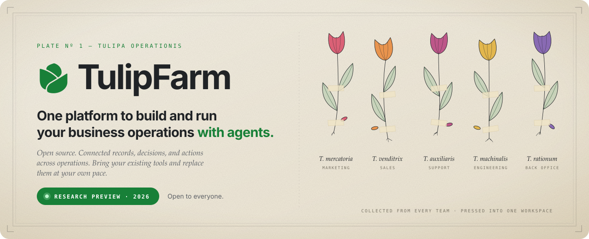
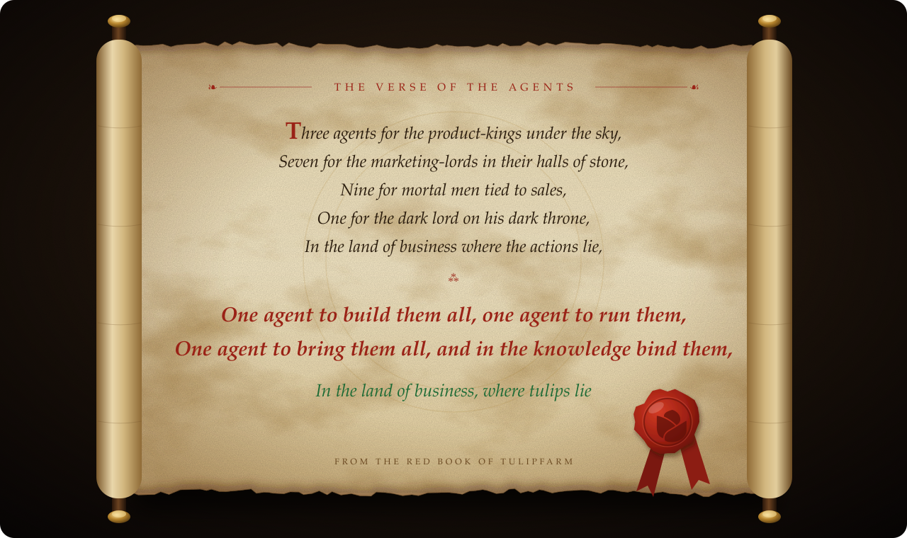

<div align="center">

<a href="https://tulipfarm.ai"></a>

<h2>One platform to build and run your business operations with agents.</h2>

<h3>Open source. Connected records, decisions, and actions across operations. Bring your existing tools and replace them at your own pace.</h3>

<p>
  <a href="LICENSE"></a>
  <a href="https://tulipfarm.ai"></a>
  <a href="https://docs.tulipfarm.ai"></a>
</p>

<p>
  <a href="https://tulipfarm.ai"><b>Website</b></a> ·
  <a href="https://tulipfarm.ai"><b>Try Cloud free</b></a> ·
  <a href="https://docs.tulipfarm.ai"><b>Docs</b></a> ·
  <a href="https://docs.tulipfarm.ai/self-hosting/"><b>Self-host</b></a> ·
  <a href="https://www.reddit.com/r/TulipFarmAI/"><b>Community</b></a>
</p>

</div>

Marketing plans in docs. Sales lives in a CRM. Support works the inbox. The back
office has the spreadsheet. Every answer means a copy and paste between them.

**TulipFarm brings your records, docs, agents and workflows into one
workspace.** Ask in Slack or chat, and agents do the work from the same
information as your team. You decide which actions wait for a person's OK.

<div align="center">

**⭐ If this is the kind of tool you want to exist, star the repo. It helps other teams find it.**

</div>

<br>

<div align="center">

</div>

<br>

## What you get

| Feature                    | What it does                                                                           |
| -------------------------- | -------------------------------------------------------------------------------------- |
| 🌱 **Bud**                 | A built-in personal assistant in every workspace.                                      |
| 🤖 **Agents**              | Saved assistants with their own name, instructions, model, skills and allowed actions. |
| 📜 **Skills**              | Reusable step-by-step procedures that an agent can follow.                             |
| 🔁 **Workflows**           | Reusable automations with approval steps. Each execution is a run.                     |
| 🗂️ **Tables**              | Business objects you define, such as Customers or Invoices. Each record is a row.      |
| 📚 **Files and Knowledge** | A file library and the source material that chats and agents can search and cite.      |
| 🔌 **Connections**         | Authorized links to the apps you already use, such as Gmail or Slack.                  |
| 👥 **Projects**            | Shared spaces for a team's chats, files and instructions.                              |

## Built so you can trust it

- **Bad data stays out.** Field rules reject bad values before they save, like
  words in a number field.
- **You decide at the gates you set.** Pick which actions wait for your OK. The
  agent shows the proposed change, then waits until a person approves it.
- **Work picks up where it stopped.** Workflows run on
  [Temporal](https://temporal.io), so a restart mid-run doesn't lose the work.
- **Open source.** The workspace, agents and workflows are here under AGPL v3.0.
  Read the code, run it and change it.

## Get started

**☁️ TulipFarm Cloud.** The fastest way in. [Sign up at tulipfarm.ai](https://tulipfarm.ai):
the research preview is open to everyone, your first signup includes free
credits, and no card is needed.

**🏡 Self-host.** Run it on your own servers with the
[self-hosting guide](https://docs.tulipfarm.ai/self-hosting/) and
[`self-host/`](self-host/README.md). Self-hosted installs are unsupported, so you
run the servers, upgrades and security yourself.

**🛠️ Develop locally.**

```sh
pnpm install
pnpm lint
pnpm dev
```

`pnpm dev` starts PostgreSQL, Temporal and S3-compatible object storage with
Docker Compose, then runs the apps. See [DEVELOPMENT.md](DEVELOPMENT.md) for
prerequisites and commands.

## Under the hood

This repository is the TulipFarm monorepo: the React web app (`apps/web`), the
HTTP API (`apps/api`), the Temporal worker (`apps/worker`) and shared domain
packages (`packages/`). It uses TypeScript, pnpm workspaces, Turborepo,
PostgreSQL with pgvector, and Oxlint.

## Research preview

TulipFarm is early and changes quickly. Expect rough edges and breaking changes.
Tell us what breaks and what you'd want an agent to do: open an
[issue](https://github.com/TulipFarm/tulipfarm/issues), post in
[r/TulipFarmAI](https://www.reddit.com/r/TulipFarmAI/), or email
hello@tulipfarm.ai.

## Contributing and security

- [CONTRIBUTING.md](CONTRIBUTING.md): how to propose changes.
- [SECURITY.md](SECURITY.md): how to report a vulnerability.
- [CHANGELOG.md](CHANGELOG.md): notable changes.

## License

TulipFarm is licensed under the [GNU Affero General Public License v3.0](LICENSE)
(`AGPL-3.0-only`).

<div align="center">
<br>
<a href="https://github.com/TulipFarm/tulipfarm/stargazers"></a>
<br><br>
<sub>Your team's work, in full bloom 🌷</sub>
</div>
